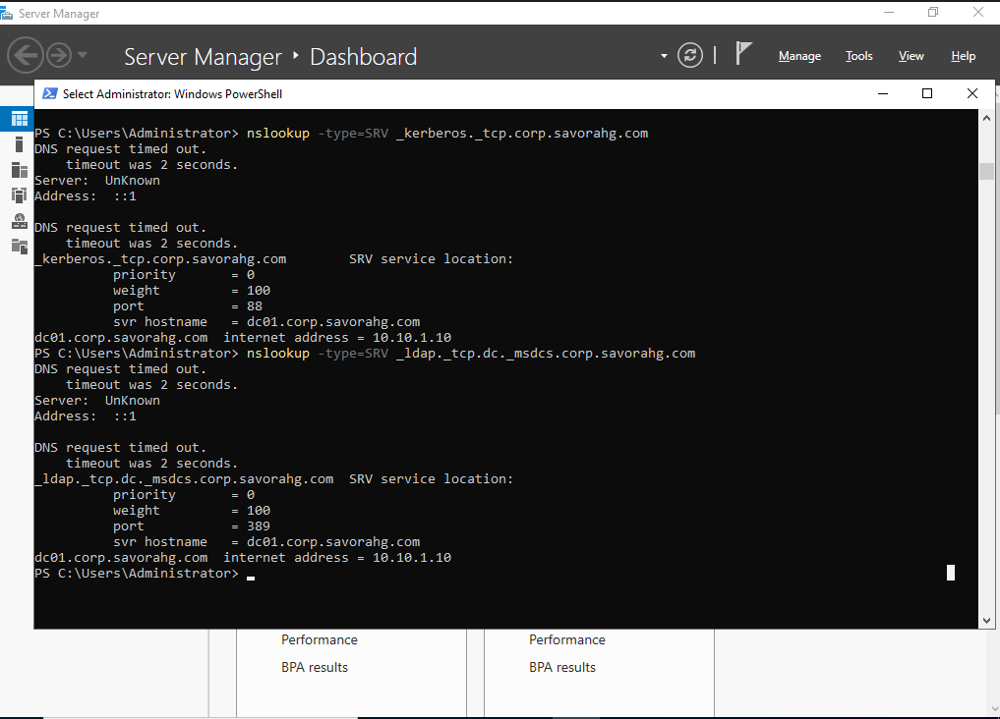
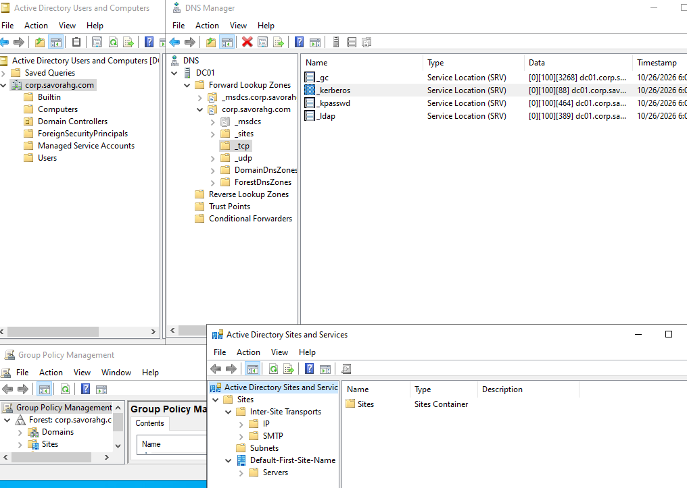

# Build DC01 and Create the Forest

**Guide 02 of 10** - *Promote the first domain controller and verify DNS and AD health*

| Item | Detail |
| --- | --- |
| Goal | A working forest corp.savorahg.com with DC01 holding all FSMO roles and healthy DNS. |
| Estimated time | 1.5 hours |
| VMs used | DC01 |
| Prerequisite | Guide 01 complete |
| Snapshot at the end | 02-DC01-Forest |

> **Concept:** A **forest** is the top security boundary in AD. A **domain** is a partition inside it. DNS is the locator service: clients find a DC by looking up SRV records, so if DNS is wrong, nothing in AD works.


## Build Steps


### Step 1: Rename the server and set a static IP

Sign in to DC01 as Administrator and open an elevated PowerShell. Check your adapter name first with `Get-NetAdapter`; replace `Ethernet` below if yours differs.

```powershell
New-NetIPAddress -InterfaceAlias "Ethernet" -IPAddress 10.10.1.10 -PrefixLength 24
Set-DnsClientServerAddress -InterfaceAlias "Ethernet" -ServerAddresses 10.10.1.10
Rename-Computer -NewName "DC01" -Restart
```


### Step 2: Install the AD DS role

```powershell
Install-WindowsFeature AD-Domain-Services -IncludeManagementTools
```

GUI alternative: Server Manager > Manage > Add Roles and Features > Server Roles >  Active Directory Domain Services > Add Features > Next until Install.


### Step 3: Promote the server and create the forest

```powershell
$dsrm = Read-Host -AsSecureString "DSRM password"
Install-ADDSForest -DomainName "corp.savorahg.com" -DomainNetbiosName "SAVORA" -ForestMode WinThreshold -DomainMode WinThreshold -InstallDns -SafeModeAdministratorPassword $dsrm -Force
```

GUI alternative: Server Manager flag > Promote this server to a domain controller > **Add a new forest** > root domain name `corp.savorahg.com` > set functional level and DSRM password > Set NetBIOS Name 'SAVORA' > accept defaults > Install.

> **Tip:** A warning that a delegation for this DNS zone cannot be created is normal in a lab with no parent DNS zone. Ignore it.


### Step 4: Reboot and sign in to the domain

The server restarts by itself. Sign in as `SAVORA\Administrator`.


### Step 5: Verify AD and DNS health

```powershell
dcdiag /v
Get-ADDomain | Select-Object DNSRoot, NetBIOSName, DomainMode
Get-ADForest | Select-Object Name, ForestMode, SchemaMaster, DomainNamingMaster
netdom query fsmo
nslookup -type=SRV _kerberos._tcp.corp.savorahg.com
nslookup -type=SRV _ldap._tcp.dc._msdcs.corp.savorahg.com
```

> **Expected result:** `dcdiag` shows passed for all tests (a warning about no other DCs is fine). `netdom query fsmo` lists DC01 for all five roles. The SRV lookups return DC01.corp.savorahg.com on ports 88 (Kerberos) and 389 (LDAP).

> **Portfolio screenshot:** Output of `netdom query fsmo` and the Kerberos SRV record lookup.


### Step 6: Turn on the AD Recycle Bin

```powershell
Enable-ADOptionalFeature -Identity "Recycle Bin Feature" -Scope ForestOrConfigurationSet -Target "corp.savorahg.com" -Confirm:$false
```

This cannot be undone, which is exactly why it is safe: it lets you restore deleted AD objects in Guide 09.


### Step 7: Create the lab folder and save vars.ps1

```powershell
New-Item -ItemType Directory -Path C:\Lab -Force
notepad C:\Lab\vars.ps1
```

Paste the contents of vars.ps1 from Guide 00 and save.


### Step 8: Explore the console tools

Open each tool once and look around: **Active Directory Users and Computers**, **DNS Manager** (find the `_msdcs`, `_tcp` and `_kerberos` records), **Group Policy Management**, **Active Directory Sites and Services**. Notice the Domain Controllers OU and the Builtin and Users containers.

> **Portfolio screenshot:** DNS Manager showing the _kerberos._tcp SRV record under corp.savorahg.com.



### Step 9: Snapshot

Shut down cleanly and take snapshot `02-DC01-Forest`.


## Completion Checklist

- [ ] DC01 has static IP 10.10.1.10 and DNS points to itself
- [ ] dcdiag passes
- [ ] SRV records for _kerberos and _ldap resolve
- [ ] Recycle Bin enabled
- [ ] C:\\Lab\\vars.ps1 saved
- [ ] Snapshot 02-DC01-Forest taken


## Troubleshooting

| Symptom | Likely cause | Fix |
| --- | --- | --- |
| Prerequisite check fails on password | Local Administrator has a blank password | Set a password with `net user Administrator <password>` |
| dcdiag DNS test fails | NIC DNS points elsewhere | Set the DNS server to 10.10.1.10 and run `ipconfig /registerdns` |
| Promotion error about NetBIOS name | Name already in use on the network | Use another NetBIOS name or isolate the VM network |
| Slow first login after reboot | AD services still starting | Wait 5 minutes and retry |


## Next

Open [03_Build_OUs_Groups_and_Users.md](03_Build_OUs_Groups_and_Users.md).
