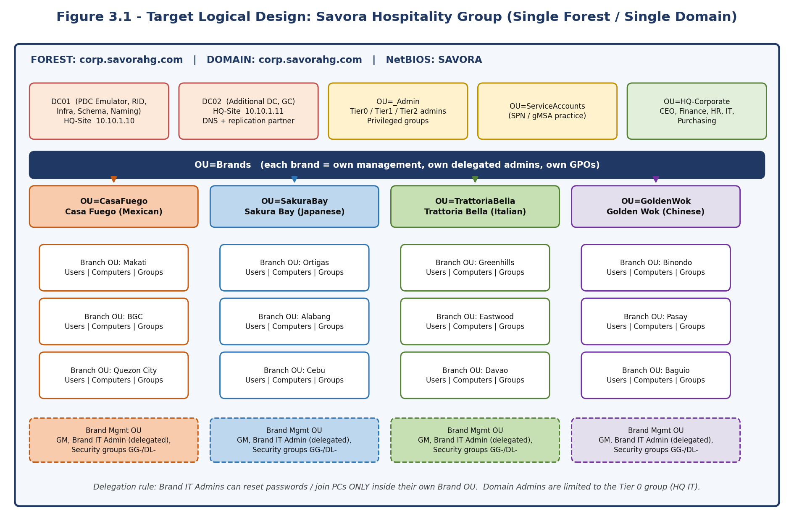
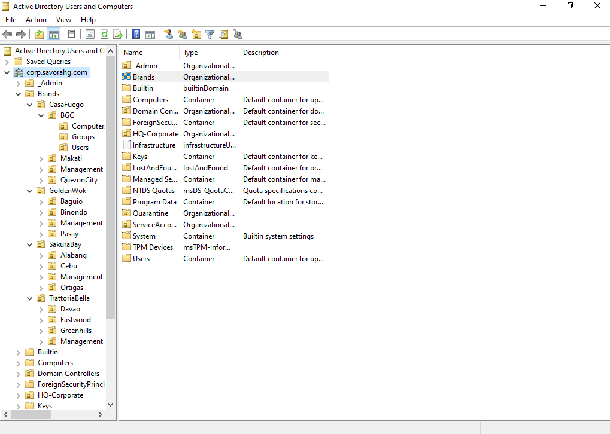
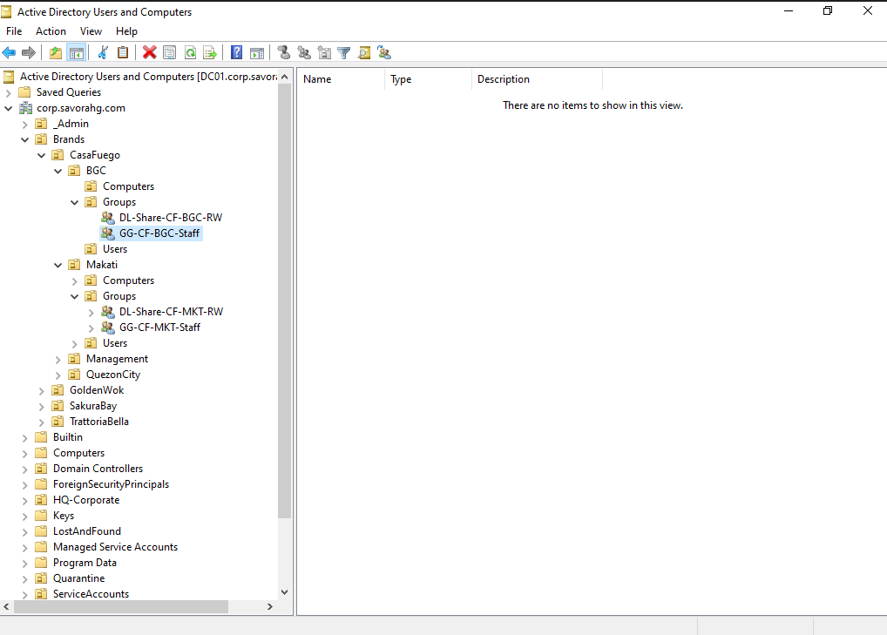
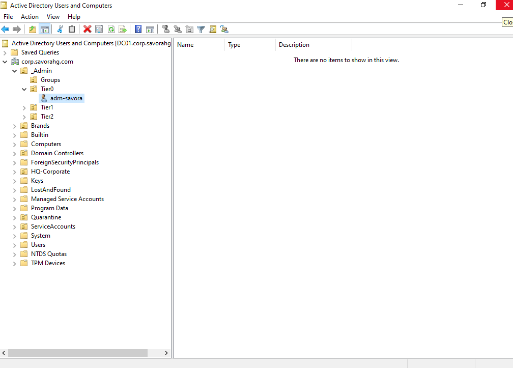
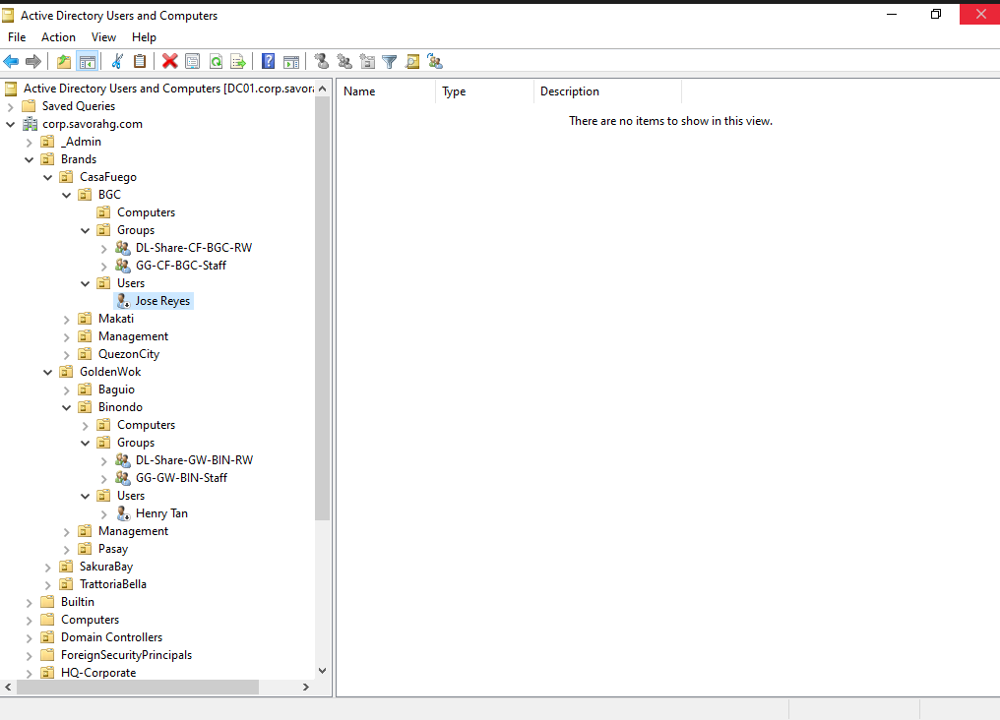

# Build OUs, Groups and Users

**Guide 03 of 10** - *Turn the company structure into Active Directory objects*

| Item | Detail |
| --- | --- |
| Goal | The full OU tree for HQ, 4 brands and 12 branches, role groups, AGDLP resource groups, admin accounts and sample users. |
| Estimated time | 2 hours |
| VMs used | DC01 |
| Prerequisite | Guide 02 complete; vars.ps1 saved on DC01 |
| Snapshot at the end | 03-AD-Structure |



*Figure 3.1 - Target logical design*


## Build Steps


### Step 1: Create the OU tree

**Script 3.1 - Create all OUs**

```powershell
. C:\Lab\vars.ps1
foreach ($ou in "_Admin","HQ-Corporate","Brands","ServiceAccounts","Quarantine") {
    New-ADOrganizationalUnit -Name $ou -Path $base -ProtectedFromAccidentalDeletion $true
}
foreach ($sub in "Users","Computers","Groups","Servers") { New-ADOrganizationalUnit -Name $sub -Path "OU=HQ-Corporate,$base" }
foreach ($sub in "Tier0","Tier1","Tier2","Groups")        { New-ADOrganizationalUnit -Name $sub -Path "OU=_Admin,$base" }

foreach ($b in $brands.Keys) {
    $brandDN = "OU=$b,OU=Brands,$base"
    New-ADOrganizationalUnit -Name $b -Path "OU=Brands,$base"
    New-ADOrganizationalUnit -Name "Management" -Path $brandDN
    foreach ($br in $brands[$b].Branches.Keys) {
        New-ADOrganizationalUnit -Name $br -Path $brandDN
        foreach ($sub in "Users","Computers","Groups") { New-ADOrganizationalUnit -Name $sub -Path "OU=$br,$brandDN" }
    }
}
```

> **Expected result:** In Active Directory Users and Computers, turn on View > Advanced Features and expand Brands. You see 4 brand OUs, each with Management and 3 branch OUs, and each branch has Users, Computers and Groups.

> **Portfolio screenshot:** The expanded OU tree in Active Directory Users and Computers.



### Step 2: Create role groups and AGDLP resource groups

> **Concept:** **AGDLP**: Accounts go in Global groups, Global groups go in Domain Local groups, and Domain Local groups get Permissions. You never grant permissions to a person directly.

**Script 3.2 - Groups**

```powershell
. C:\Lab\vars.ps1
$hqGroups = "OU=Groups,OU=HQ-Corporate,$base"
foreach ($b in $brands.Keys) {
    $code = $brands[$b].Code
    $mgmt = "OU=Management,OU=$b,OU=Brands,$base"
    foreach ($g in "GM","ITAdmins","Managers") { New-ADGroup -Name "GG-$code-$g" -GroupScope Global -GroupCategory Security -Path $mgmt }
    New-ADGroup -Name "DL-Share-$code-Mgmt-RW" -GroupScope DomainLocal -GroupCategory Security -Path $hqGroups
    Add-ADGroupMember -Identity "DL-Share-$code-Mgmt-RW" -Members "GG-$code-Managers","GG-$code-GM"
    foreach ($br in $brands[$b].Branches.Keys) {
        $bc = $brands[$b].Branches[$br]
        $gp = "OU=Groups,OU=$br,OU=$b,OU=Brands,$base"
        New-ADGroup -Name "GG-$code-$bc-Staff" -GroupScope Global      -GroupCategory Security -Path $gp
        New-ADGroup -Name "DL-Share-$code-$bc-RW" -GroupScope DomainLocal -GroupCategory Security -Path $gp
        Add-ADGroupMember -Identity "DL-Share-$code-$bc-RW" -Members "GG-$code-$bc-Staff"
    }
}
foreach ($g in "GG-HQ-ITAdmins","GG-HQ-Finance","GG-HQ-HR","GG-HQ-Executives") {
    New-ADGroup -Name $g -GroupScope Global -GroupCategory Security -Path $hqGroups
}
```


### Step 3: Create your admin account and put it in Tier 0

Replace `yourname` with your own. Use a long lab passphrase.

```powershell
$pw = Read-Host -AsSecureString "Admin password"
New-ADUser -Name "adm-yourname" -SamAccountName "adm-yourname" -UserPrincipalName "adm-yourname@corp.savorahg.com" -Path "OU=Tier0,OU=_Admin,$base" -AccountPassword $pw -Enabled $true -PasswordNeverExpires $false
Add-ADGroupMember -Identity "GG-HQ-ITAdmins" -Members "adm-yourname"
Add-ADGroupMember -Identity "Domain Admins" -Members "GG-HQ-ITAdmins"
```

> **Warning:** Only the Tier 0 group should hold Domain Admins. Keep this group very small. From now on, sign in with adm-yourname for administration and use SAVORA\\Administrator only for emergencies.


### Step 4: Create sample users from a CSV file

Create the CSV, then import it. These 12 rows give one branch manager per branch; add more rows later for cashiers, kitchen staff and so on.

**Script 3.3a - Create users.csv**

```powershell
@"
FirstName,LastName,Username,Brand,Branch,Title
Maria,Santos,msantos,CasaFuego,Makati,Branch Manager
Jose,Reyes,jreyes,CasaFuego,BGC,Branch Manager
Ana,Cruz,acruz,CasaFuego,QuezonCity,Branch Manager
Pedro,Garcia,pgarcia,SakuraBay,Ortigas,Branch Manager
Liza,Ramos,lramos,SakuraBay,Alabang,Branch Manager
Mark,Flores,mflores,SakuraBay,Cebu,Branch Manager
Ella,Mendoza,emendoza,TrattoriaBella,Greenhills,Branch Manager
Carlo,Bautista,cbautista,TrattoriaBella,Eastwood,Branch Manager
Rina,Torres,rtorres,TrattoriaBella,Davao,Branch Manager
Henry,Tan,htan,GoldenWok,Binondo,Branch Manager
Grace,Lim,glim,GoldenWok,Pasay,Branch Manager
Paolo,Dizon,pdizon,GoldenWok,Baguio,Branch Manager
"@ | Set-Content C:\Lab\users.csv
```

**Script 3.3b - Import users and add them to groups**

```powershell
. C:\Lab\vars.ps1
$pw = Read-Host -AsSecureString "Initial password for new users"
Import-Csv C:\Lab\users.csv | ForEach-Object {
    $ou = "OU=Users,OU=$($_.Branch),OU=$($_.Brand),OU=Brands,$base"
    New-ADUser -Name "$($_.FirstName) $($_.LastName)" -GivenName $_.FirstName -Surname $_.LastName -SamAccountName $_.Username -UserPrincipalName "$($_.Username)@corp.savorahg.com" -Title $_.Title -Company $_.Brand -Department $_.Branch -Path $ou -AccountPassword $pw -ChangePasswordAtLogon $true -Enabled $true
    $code = $brands[$_.Brand].Code
    $bc   = $brands[$_.Brand].Branches[$_.Branch]
    Add-ADGroupMember -Identity "GG-$code-$bc-Staff"    -Members $_.Username
    Add-ADGroupMember -Identity "GG-$code-Managers"     -Members $_.Username
}
```

> **Expected result:** `Get-ADUser -Filter * -SearchBase "OU=Brands,$base" | Measure-Object` shows 12 users. Each user is in their branch Users OU and in the matching GG groups.



### Step 5: Add a few more users by hand

Create at least one cashier in each of CLIENT1's and CLIENT2's branches (Makati and Ortigas) in Active Directory Users and Computers: right-click the branch Users OU > New > User. Add them to `GG-CF-MKT-Staff` and `GG-SB-ORT-Staff`. Also create one HQ user in `OU=Users,OU=HQ-Corporate` and add them to `GG-HQ-Finance`.


### Step 6: Send new computers to a safe OU

By default new computer accounts land in the generic Computers container where no policy can be linked. Redirect them to the Quarantine OU so you must place each one deliberately:

```powershell
redircmp "OU=Quarantine,DC=corp,DC=savorahg,DC=com"
redirusr "OU=Users,OU=HQ-Corporate,DC=corp,DC=savorahg,DC=com"
```


### Step 7: Snapshot

Shut down and take snapshot `03-AD-Structure`.


## Completion Checklist

- [ ] OU tree matches Figure 3.1
- [ ] Groups exist in the correct OUs
- [ ] adm- account is in GG-HQ-ITAdmins, which is in Domain Admins
- [ ] 12 CSV users plus the hand-made users exist
- [ ] redircmp configured
- [ ] Snapshot 03-AD-Structure taken


## Troubleshooting

| Symptom | Likely cause | Fix |
| --- | --- | --- |
| Cannot find path / OU does not exist | vars.ps1 not loaded or script ran out of order | Run `. C:\Lab\vars.ps1` and rerun Script 3.1 |
| New-ADUser password does not meet requirements | Domain complexity rules | Use 12+ characters with upper, lower, number and symbol |
| Add-ADGroupMember cannot find identity | Group not created yet | Run Script 3.2 first |
| Cannot delete an OU later | Protected from accidental deletion | Untick the protection in OU properties > Object tab (Advanced Features on) |


## Next

Open [04_Add_DC02_Sites_and_Replication.md](04_Add_DC02_Sites_and_Replication.md).
